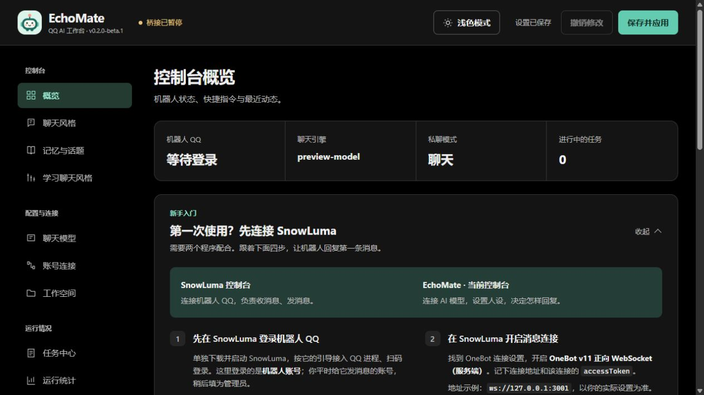

# EchoMate · QQ Codex Bridge


[](https://github.com/pinkman987/qq-codex-bridge/actions/workflows/ci.yml)

[使用说明](docs/USAGE.md) · [首次安装](docs/QUICKSTART.md) · [更新记录](CHANGELOG.md) · [下载测试版](https://github.com/pinkman987/qq-codex-bridge/releases)

本机运行的 QQ AI 机器人工作台。通过 SnowLuma 连接 QQ，选择 Codex 或第三方模型聊天；管理员可以在 QQ 下达项目任务、补充要求、回答问题，并接收工作进度和结果。

**2026-10-16 主分支更新：** 新控制台与可爱机器人标志、深浅主题、首页连接教程、供应商管理、人设库、网页试聊、工作目录选择和任务中心已同步。QQ 回复默认精简、纯文本排版，链接按需提供，账户剩余额度仅在工作成功结束后显示。

**Windows 10/11 本地测试项目，Node.js 22.13+。** 需要自行安装 QQ、SnowLuma 及所选模型服务。本次更新源码和文档，现有 `v0.2.0-beta.1` Release ZIP 保持原内容；使用新功能请更新源码并重启后台。其他电脑与真实账号仍需验收，见 [发布验收](docs/RELEASE.md)。

## 开始使用

下载源码后进入项目目录：

```powershell
npm ci
npm start
```

也可双击 `start.cmd`。首次安装会下载依赖，控制页自动打开。

1. 单独安装 [SnowLuma](https://github.com/SnowLuma/SnowLuma/releases/latest)，登录机器人 QQ，开启 OneBot v11 正向 WebSocket。
2. 在「聊天模型」选择 Codex，或添加自己的 API 供应商、密钥和模型。
3. 在「账号连接」填写管理员 QQ、群白名单、WebSocket 地址及连接令牌，启用桥接后保存。
4. 看到「QQ 已连接」后，管理员私聊 `/mode chat` 开始聊天，群里 @机器人。要执行项目任务，先配置 Codex 再发 `/mode work`。

首页有完整的四步教程。SnowLuma 负责连接 QQ，EchoMate 负责 AI 和工作任务，两个后台都要保持运行。



截图使用隔离假配置，没有真实 QQ、密钥或私人聊天内容。

## 能做什么

| 功能 | 当前范围 |
| --- | --- |
| 人设与试聊 | 预设库、载入编辑、网页测试已保存设置或页面草稿；试聊不发送 QQ |
| 记忆与话题 | 分会话管理长期记忆、近期上下文和待续话题；添加后立即显示 |
| 模型管理 | Codex 登录、多 API 供应商、多模型；OpenAI / Anthropic 格式 |
| 搜索与图片 | 按引擎能力启用联网搜索；同会话近期图片追问；链接按需提供 |
| 项目工作 | 管理员在 QQ 发任务、补充、停止、审批；网页任务中心看进度与结果 |
| 工作目录 | 首页选项目、手动填路径或使用 Windows 文件夹选择器 |
| QQ 回复 | 默认约 120–220 字，纯文本分行；缺关键信息直接问，完成后报剩余额度 |
| 风格学习 | 消息库、粘贴、文件/文件夹、截图导入；校对后再分析并加入人设 |
| 控制台 | 浅色/纯黑主题、首页教程、手机布局、固定保存操作、配置冲突保护 |
| 统计 | 调用、耗时、失败与服务返回用量；读取不到明确显示未知 |

语音/Omni 界面入口暂时移除，后台保留旧配置兼容。当前没有定时主动私聊功能；群聊主动参与仍可单独设置。详细边界见 [功能说明](docs/FEATURES.md) 和 [多模态兼容说明](docs/COMPANION.md)。

## 数据与权限

控制页只监听 `127.0.0.1`，使用随机令牌鉴权。不要分享带令牌的控制页地址。真实配置和密钥保存在 `config.json`，会话、记忆和任务记录在 `state/`；这些内容与本机备份不得上传。

聊天引擎不能执行本地工作工具；管理员工作任务按客户端规则申请审批，普通回答不会批准操作。OCR 在本机完成，校对确认后的记录、聊天上下文会发送给所选模型。模型输出可能错误，使用前应检查。见 [安全与隐私](SECURITY.md)。

## 升级与验证

升级前备份 `config.json`、`state/`。更新源码后停止旧后台再启动；刷新网页或重复打开会复用旧进程的启动器，不能加载新的后台逻辑。

```powershell
npm run check
npm test
npm run smoke
```

当前 208 项隔离测试、58 个脚本及界面/版本检查、模拟启动检查通过，未使用真实 QQ 或付费模型进行自动测试。CI 覆盖 Windows/Ubuntu 与 Node 22.13/24，远端结果以实际运行记录为准。

[排查与升级](docs/TROUBLESHOOTING.md) · [界面变更](docs/UI.md) · [开发约束](CONTRIBUTING.md) · [发布流程](docs/RELEASE.md)

## 许可

项目代码与自制机器人图标采用 [MIT](LICENSE)。第三方组件与素材见 [第三方声明](THIRD-PARTY-NOTICES.md)。QQ、SnowLuma、Codex 独立安装，适用各自许可。
